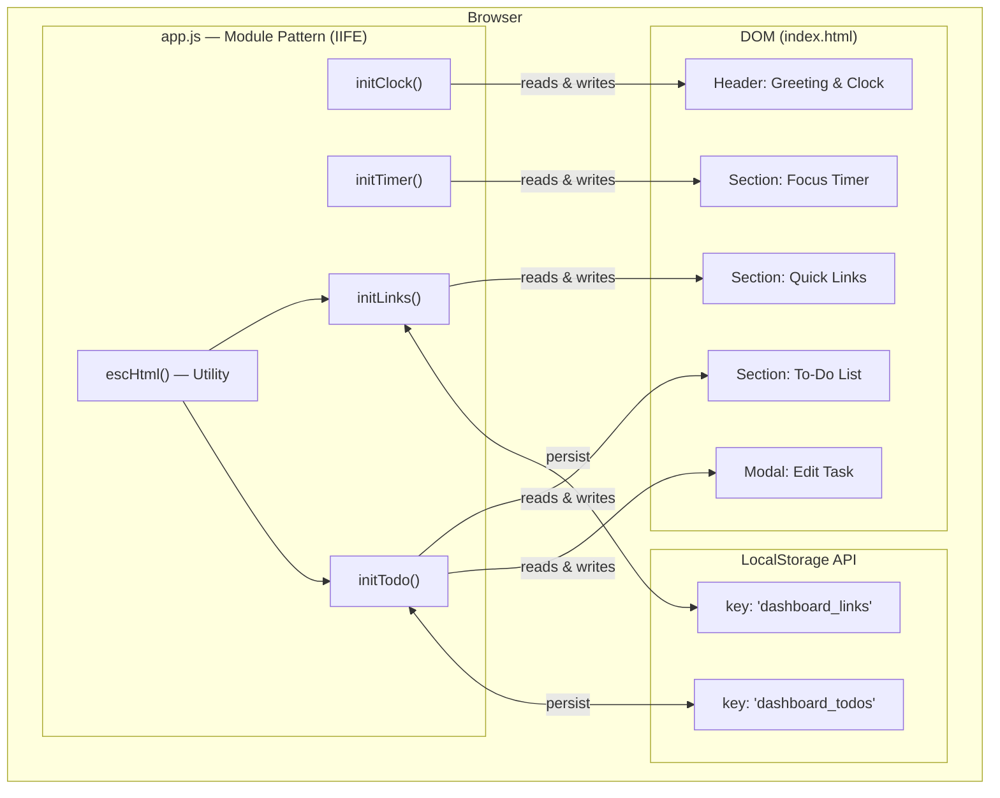
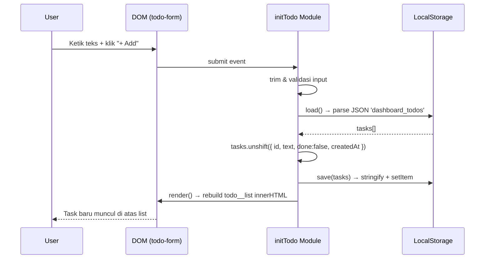
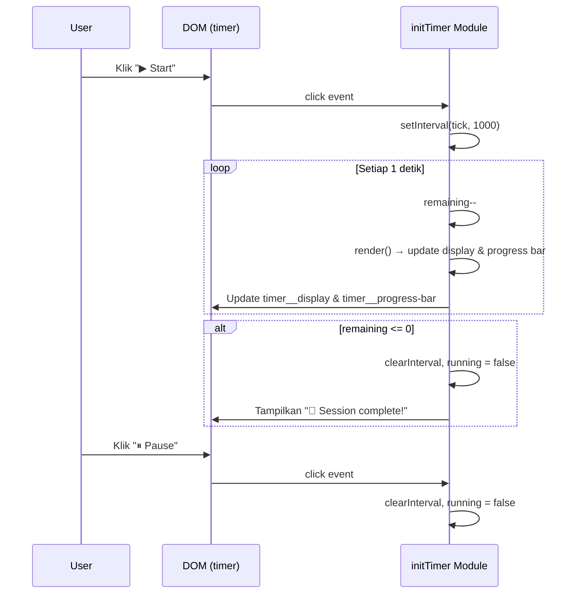
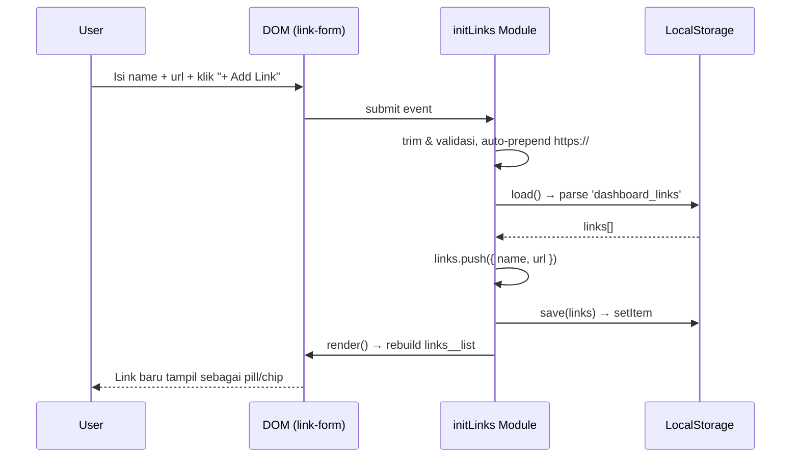

# Design Document: To-Do List Life Dashboard

## Overview

To-Do List Life Dashboard adalah sebuah aplikasi web all-in-one berbasis browser yang menggabungkan empat fitur produktivitas utama—Greeting & Clock, Focus Timer, To-Do List, dan Quick Links—dalam satu halaman yang bersih dan responsif. Aplikasi ini dibangun sepenuhnya menggunakan HTML, CSS, dan Vanilla JavaScript tanpa ketergantungan pada framework atau library eksternal, sehingga semua logika berjalan langsung di browser pengguna dengan data yang disimpan menggunakan LocalStorage API.

Arsitektur yang dipilih adalah single-page application (SPA) sederhana dengan pola **Module Pattern** menggunakan IIFE (Immediately Invoked Function Expression), di mana setiap fitur dikapsulasi dalam modul tersendiri yang independen, tidak saling berkomunikasi secara langsung, namun semuanya beroperasi pada DOM yang sama dan LocalStorage sebagai layer persistensi data.

---

## Architecture



---

## Sequence Diagrams

### Flow: Tambah Task Baru



### Flow: Timer Countdown (Focus Timer)



### Flow: Tambah Quick Link



---

## Components and Interfaces

### Component 1: initClock — Greeting & Clock

**Purpose**: Menampilkan jam digital real-time, tanggal lengkap, dan pesan sapaan berdasarkan waktu hari.

**Interface**:
```javascript
// Tidak menerima parameter; IIFE yang berjalan sekali saat halaman load
(function initClock(): void)

// Internal helpers
function getGreeting(hour: number): string
// → '🌙 Good night!' | '☀️ Good morning!' | '🌤 Good afternoon!' | '🌆 Good evening!'

function pad(n: number): string
// → string 2-digit, contoh: 9 → "09"

function tick(): void
// → Update textContent pada #clock, #greeting-text, #date-text
```

**Responsibilities**:
- Membaca waktu saat ini via `new Date()` setiap detik
- Menentukan kategori sapaan berdasarkan jam (< 5 = malam, < 12 = pagi, < 17 = siang, < 21 = sore, else = malam)
- Memformat waktu dalam format `HH:MM:SS`
- Memformat tanggal sebagai `Day, DD Month YYYY`

---

### Component 2: initTimer — Focus Timer

**Purpose**: Mengelola countdown timer 25 menit (Pomodoro) dengan kontrol Start/Pause/Reset dan progress bar visual.

**Interface**:
```javascript
(function initTimer(): void)

// Internal functions
function render(): void
// → Update #timer-display, #timer-bar width%

function start(): void
// → Guard: if running return; set interval, update status label

function stop(): void
// → clearInterval, running = false, update label "⏸ Paused"

function reset(): void
// → clearInterval, remaining = TOTAL_SECONDS (1500), render()
```

**State (closure variables)**:
```javascript
const TOTAL_SECONDS: number = 1500  // 25 * 60
let remaining: number               // detik tersisa
let interval: ReturnType<typeof setInterval> | null
let running: boolean
```

**Responsibilities**:
- Menjalankan countdown 1 detik per tick via `setInterval`
- Menghitung persentase progress: `((TOTAL_SECONDS - remaining) / TOTAL_SECONDS) * 100`
- Meng-update lebar `timer__progress-bar` setiap tick
- Menangani kondisi selesai: clear interval, tampilkan pesan sukses
- Mencegah multiple interval dengan guard `if (running) return`

---

### Component 3: initLinks — Quick Links

**Purpose**: Mengelola daftar link favorit yang dapat ditambah dan dihapus, dengan persistensi ke LocalStorage.

**Interface**:
```javascript
(function initLinks(): void)

// Internal functions
function load(): LinkItem[]
// → Parse JSON dari localStorage 'dashboard_links', fallback []

function save(data: LinkItem[]): void
// → JSON.stringify + localStorage.setItem

function getFavicon(url: string): string | null
// → `https://www.google.com/s2/favicons?domain=${host}&sz=16` atau null

function render(): void
// → Rebuild #links-list innerHTML; tampilkan empty state jika kosong
```

**Data Types**:
```javascript
interface LinkItem {
  name: string  // maks 30 karakter
  url:  string  // URL valid dengan protokol https://
}
```

**Responsibilities**:
- Auto-prepend `https://` jika URL tidak dimulai dengan protokol
- Mengambil favicon via Google Favicon API
- Escape HTML untuk mencegah XSS via `escHtml()`
- Hapus link berdasarkan index array

---

### Component 4: initTodo — To-Do List

**Purpose**: Mengelola task dengan operasi lengkap (add, edit, toggle done, delete, filter, clear completed) dan persistensi ke LocalStorage.

**Interface**:
```javascript
(function initTodo(): void)

// Internal functions
function load(): TaskItem[]
function save(tasks: TaskItem[]): void
function uid(): string
// → ID unik: Date.now().toString(36) + Math.random().toString(36).slice(2)

function updateStats(tasks: TaskItem[]): void
// → Update #stats-total, #stats-done, #stats-pending

function render(): void
// → Filter berdasarkan activeFilter, rebuild #todo-list innerHTML

function openModal(): void
function closeModal(): void
```

**State (closure variables)**:
```javascript
let activeFilter: 'all' | 'pending' | 'done' = 'all'
let editingId: string | null = null
```

**Data Types**:
```javascript
interface TaskItem {
  id:        string   // UID unik
  text:      string   // maks 120 karakter
  done:      boolean  // status selesai
  createdAt: number   // timestamp Unix ms
}
```

**Responsibilities**:
- Tambah task baru di posisi teratas (`unshift`)
- Toggle status `done` berdasarkan task ID
- Edit teks task via modal dialog
- Hapus task individual berdasarkan ID
- Filter tampilan: All / Pending / Done
- Hapus semua task yang sudah `done`
- Update statistik (total, done, pending) setiap render
- Tutup modal saat klik overlay atau tekan Escape

---

### Component 5: escHtml — Utility

**Purpose**: Sanitasi string input pengguna untuk mencegah XSS saat di-render ke innerHTML.

**Interface**:
```javascript
function escHtml(str: string): string
// → Escape: & < > " '
// → Contoh: '<script>' → '&lt;script&gt;'
```

---

## Data Models

### Model 1: TaskItem (LocalStorage key: `dashboard_todos`)

```javascript
interface TaskItem {
  id:        string   // UID: contoh "lf2k3a8b9c"
  text:      string   // Teks task, 1–120 karakter
  done:      boolean  // false = pending, true = selesai
  createdAt: number   // Date.now() saat dibuat
}
```

**Struktur di LocalStorage**:
```json
[
  {
    "id": "lf2k3a8b9c",
    "text": "Belajar JavaScript",
    "done": false,
    "createdAt": 1729123200000
  },
  {
    "id": "lf2k3a7xyz",
    "text": "Review PR",
    "done": true,
    "createdAt": 1729119600000
  }
]
```

**Validation Rules**:
- `text` tidak boleh kosong setelah `.trim()`
- `text` maksimal 120 karakter (dibatasi via `maxlength` attribute HTML)
- `id` dihasilkan oleh `uid()`, tidak boleh duplikat
- `done` harus boolean (tidak nullable)

---

### Model 2: LinkItem (LocalStorage key: `dashboard_links`)

```javascript
interface LinkItem {
  name: string  // Label tampilan, 1–30 karakter
  url:  string  // URL lengkap dengan protokol https://
}
```

**Struktur di LocalStorage**:
```json
[
  { "name": "YouTube",  "url": "https://youtube.com" },
  { "name": "GitHub",   "url": "https://github.com"  }
]
```

**Validation Rules**:
- `name` tidak boleh kosong, maks 30 karakter
- `url` harus merupakan URL valid (divalidasi via `type="url"` di HTML)
- `url` otomatis ditambahkan `https://` jika tidak ada protokol
- Tidak ada batas jumlah link (dibatasi memori LocalStorage ~5MB)

---

## Algorithmic Pseudocode

### Algorithm 1: Timer Countdown

```pascal
ALGORITHM timerTick()
INPUT:  remaining (integer, detik tersisa)
        TOTAL_SECONDS (constant = 1500)
OUTPUT: Update DOM setiap detik; emit complete event saat 0

BEGIN
  IF remaining <= 0 THEN
    clearInterval(interval)
    running ← false
    displayEl.textContent ← "00:00"
    barEl.style.width ← "0%"
    statusEl.textContent ← "🎉 Session complete! Take a break."
    RETURN
  END IF

  remaining ← remaining - 1

  m ← FLOOR(remaining / 60)
  s ← remaining MOD 60
  displayEl.textContent ← pad(m) + ":" + pad(s)

  pct ← ((TOTAL_SECONDS - remaining) / TOTAL_SECONDS) × 100
  barEl.style.width ← (100 - pct) + "%"
END
```

**Preconditions:**
- `remaining` adalah integer ≥ 0
- `TOTAL_SECONDS` = 1500 (konstan)
- `interval` sudah di-set oleh `setInterval(timerTick, 1000)`

**Postconditions:**
- `displayEl` menampilkan MM:SS yang akurat
- `barEl` lebar menurun dari 100% ke 0% secara proporsional
- Saat `remaining = 0`, timer berhenti dan status berubah

**Loop Invariants:**
- Setiap tick: `remaining + ticksElapsed = TOTAL_SECONDS`
- `barEl.width%` = `(TOTAL_SECONDS - remaining) / TOTAL_SECONDS × 100`

---

### Algorithm 2: Render To-Do List

```pascal
ALGORITHM renderTodoList()
INPUT:  activeFilter ('all' | 'pending' | 'done')
        tasks[] dari LocalStorage
OUTPUT: Rebuild #todo-list DOM

BEGIN
  tasks ← load() dari LocalStorage
  updateStats(tasks)

  visible ← FILTER tasks WHERE:
    IF activeFilter = 'done'    → task.done = true
    IF activeFilter = 'pending' → task.done = false
    IF activeFilter = 'all'     → semua task

  listEl.innerHTML ← ''

  IF visible.length = 0 THEN
    msg ← getEmptyStateMessage(activeFilter)
    listEl.innerHTML ← emptyStateHTML(msg)
    RETURN
  END IF

  FOR each task IN visible DO
    li ← createElement('li')
    li.className ← 'task-item' + (task.done ? ' done' : '')
    li.dataset.id ← task.id
    li.innerHTML ← buildTaskItemHTML(task)
    listEl.appendChild(li)
  END FOR
END
```

**Preconditions:**
- `activeFilter` adalah salah satu dari tiga nilai valid
- `load()` mengembalikan array valid (bisa kosong)
- DOM element `#todo-list` sudah ada

**Postconditions:**
- `#todo-list` berisi elemen sesuai filter aktif
- Stats counter (`#stats-total`, `#stats-done`, `#stats-pending`) sudah diupdate
- Setiap `li` memiliki `data-id` untuk event delegation

**Loop Invariants:**
- Semua task yang sudah diproses telah di-append ke DOM
- Tidak ada duplikasi berdasarkan `task.id`

---

### Algorithm 3: Load & Save LocalStorage

```pascal
ALGORITHM load(key)
INPUT:  key (string) — 'dashboard_todos' atau 'dashboard_links'
OUTPUT: array[] (parsed JSON) atau [] jika error/kosong

BEGIN
  raw ← localStorage.getItem(key)
  IF raw = null THEN
    RETURN []
  END IF

  TRY
    result ← JSON.parse(raw)
    RETURN result
  CATCH error
    RETURN []    // fallback jika data corrupt
  END TRY
END

ALGORITHM save(key, data)
INPUT:  key (string), data (array)
OUTPUT: void — side effect ke LocalStorage

BEGIN
  serialized ← JSON.stringify(data)
  localStorage.setItem(key, serialized)
END
```

---

### Algorithm 4: UID Generation

```pascal
ALGORITHM uid()
INPUT:  (none)
OUTPUT: string ID yang unik

BEGIN
  part1 ← Date.now().toString(36)    // timestamp dalam base-36
  part2 ← Math.random().toString(36).slice(2)  // random suffix
  RETURN part1 + part2
END
```

**Catatan**: Kombinasi timestamp + random menghasilkan ID yang praktis unik dalam konteks single-user browser app. Bukan UUID v4, namun cukup untuk localStorage key.

---

## Key Functions with Formal Specifications

### `escHtml(str)`

```javascript
function escHtml(str: string): string
```

**Preconditions:**
- `str` adalah string (bisa kosong)

**Postconditions:**
- Semua karakter `& < > " '` di-escape ke HTML entities
- Panjang output ≥ panjang input
- Tidak ada perubahan pada karakter selain yang di-escape

---

### `getGreeting(hour)`

```javascript
function getGreeting(hour: number): string
```

**Preconditions:**
- `hour` adalah integer 0–23

**Postconditions:**
- Return string emoji + teks sapaan
- Mapping: `[0,5)` → malam, `[5,12)` → pagi, `[12,17)` → siang, `[17,21)` → sore, `[21,24)` → malam

---

### `getFavicon(url)`

```javascript
function getFavicon(url: string): string | null
```

**Preconditions:**
- `url` adalah string (bisa invalid URL)

**Postconditions:**
- Return Google Favicon API URL jika `url` valid
- Return `null` jika `new URL(url)` throw error
- Tidak ada side effect

---

## Example Usage

### Menambah Task Baru

```javascript
// User submit form dengan teks "Belajar CSS Grid"
const text = "Belajar CSS Grid".trim()  // valid, tidak kosong

const tasks = load()           // [{ id: "abc", text: "Task lama", done: false, ... }]
tasks.unshift({
  id:        uid(),            // "lf2k3xyzabc"
  text:      text,             // "Belajar CSS Grid"
  done:      false,
  createdAt: Date.now()        // 1729123456789
})
save(tasks)                    // persist ke localStorage
render()                       // rebuild DOM
```

### Toggle Task Done

```javascript
// User klik checkbox pada task dengan id "lf2k3xyzabc"
const tasks = load()
const task = tasks.find(t => t.id === "lf2k3xyzabc")
task.done = !task.done          // false → true
save(tasks)
render()
// li.className akan menjadi "task-item done"
// task-text akan mendapat text-decoration: line-through
```

### Filter Hanya Pending

```javascript
activeFilter = 'pending'
// render() dipanggil, visible = tasks.filter(t => !t.done)
// Hanya task yang belum selesai yang muncul di DOM
```

### Progress Bar Timer

```javascript
// Setelah 5 menit berjalan (300 detik telah berlalu dari 1500)
const remaining = 1200
const pct = ((1500 - 1200) / 1500) * 100  // = 20%
barEl.style.width = `${100 - 20}%`         // = "80%"
// Bar masih 80% terisi, menyusut ke kiri seiring waktu
```

---

## Correctness Properties

1. **Timer tidak pernah negatif**: `∀ tick: remaining ≥ 0` — timer berhenti tepat saat `remaining = 0`
2. **Data XSS-safe**: `∀ userInput: render(escHtml(userInput))` — tidak ada raw HTML dari user yang masuk ke DOM
3. **LocalStorage consistency**: `∀ operation: save(tasks) → load() === tasks` — data yang tersimpan selalu dapat di-restore
4. **UID uniqueness** (praktis): Probabilitas collision `uid()` dalam single-user session mendekati 0 karena timestamp berbeda setiap millisecond
5. **Filter completeness**: `count(all) = count(pending) + count(done)` — selalu berlaku pada setiap state
6. **Timer single interval**: `∀ state: running = true → exactly one setInterval active` — guard `if (running) return` memastikan tidak ada multiple interval
7. **Stats accuracy**: `statTotal = tasks.length`, `statDone = tasks.filter(t => t.done).length`, `statPending = statTotal - statDone`

---

## Error Handling

### Skenario 1: LocalStorage Corrupt / Parse Error

**Kondisi**: Data di LocalStorage tidak valid JSON (misalnya karena storage penuh atau modifikasi manual)
**Respons**: `try-catch` di `load()` mengembalikan `[]` (array kosong)
**Recovery**: Aplikasi berjalan normal dengan state kosong; data lama hilang tapi tidak crash

### Skenario 2: URL Tidak Valid di Quick Links

**Kondisi**: User memasukkan URL tanpa protokol, misalnya `google.com`
**Respons**: Auto-prepend `https://` → menjadi `https://google.com`
**Recovery**: Link tetap tersimpan dan berfungsi

### Skenario 3: Favicon Tidak Tersedia

**Kondisi**: `new URL(url)` gagal atau Google Favicon API tidak merespons
**Respons**: `getFavicon()` return `null`; render tidak menyertakan `` tag
**Recovery**: Link tetap tampil dengan teks nama saja, tanpa ikon

### Skenario 4: Input Kosong pada Form

**Kondisi**: User submit form tanpa mengisi field yang diperlukan
**Respons**: HTML5 `required` attribute mencegah submit; browser menampilkan validation UI
**Recovery**: User tidak dapat submit; tidak ada data yang rusak

### Skenario 5: Multiple Timer Start

**Kondisi**: User menekan tombol Start berkali-kali
**Respons**: Guard `if (running) return` di fungsi `start()` mengabaikan klik berikutnya
**Recovery**: Hanya satu `setInterval` yang aktif pada satu waktu

---

## Testing Strategy

### Unit Testing Approach

Test setiap fungsi helper secara terisolasi:

```javascript
// escHtml
assert(escHtml('<script>') === '&lt;script&gt;')
assert(escHtml('"hello"') === '&quot;hello&quot;')
assert(escHtml('') === '')

// getGreeting
assert(getGreeting(4)  === '🌙 Good night!')
assert(getGreeting(9)  === '☀️ Good morning!')
assert(getGreeting(14) === '🌤 Good afternoon!')
assert(getGreeting(19) === '🌆 Good evening!')
assert(getGreeting(23) === '🌙 Good night!')

// uid — uniqueness
const ids = Array.from({ length: 1000 }, uid)
assert(new Set(ids).size === 1000)
```

### Property-Based Testing Approach

**Property Test Library**: `fast-check` (JavaScript)

```javascript
// Property 1: escHtml idempoten untuk output-nya sendiri
fc.property(fc.string(), str => {
  const once  = escHtml(str)
  const twice = escHtml(once)
  return once === twice  // escaping twice = same result
})

// Property 2: Filter consistency
fc.property(fc.array(taskItemArbitrary), tasks => {
  const pending = tasks.filter(t => !t.done)
  const done    = tasks.filter(t =>  t.done)
  return pending.length + done.length === tasks.length
})

// Property 3: Timer tidak pernah negatif
fc.property(fc.integer({ min: 0, max: 1500 }), remaining => {
  const next = remaining > 0 ? remaining - 1 : 0
  return next >= 0
})
```

### Integration Testing Approach

- **LocalStorage round-trip**: Simpan data → clear modul → load kembali → verifikasi identik
- **Filter + Stats sync**: Tambah 3 task, selesaikan 1 → filter pending menampilkan 2, stats menunjukkan "1 done 2 pending"
- **Modal edit flow**: Buka modal → ubah teks → save → verifikasi DOM dan LocalStorage update
- **Timer lifecycle**: Start → tunggu 3 detik → Pause → verifikasi `remaining = 1497` → Reset → verifikasi `remaining = 1500`

---

## Performance Considerations

- **DOM Re-render**: Setiap operasi memanggil `render()` penuh yang membangun ulang `innerHTML`. Ini cukup untuk jumlah task yang wajar (< 1000). Untuk skala lebih besar, pertimbangkan diffing atau virtual list.
- **setInterval overhead**: Hanya satu interval aktif pada satu waktu (dijamin oleh guard `running`). Overhead sangat minimal.
- **LocalStorage read frequency**: Setiap operasi CRUD membaca LocalStorage secara sinkron. Untuk data kecil (< 100 item), latensi dapat diabaikan.
- **Favicon API**: Request ke Google Favicon API terjadi saat render; ini adalah network request eksternal yang bisa lambat. Sudah diantisipasi dengan fallback graceful (tanpa ikon).

---

## Security Considerations

- **XSS Prevention**: Semua user-generated content di-sanitasi via `escHtml()` sebelum dimasukkan ke `innerHTML`. Ini mencegah stored XSS dari teks task maupun nama link.
- **URL Sanitasi**: Link menggunakan `rel="noopener noreferrer"` dan `target="_blank"` untuk mencegah reverse tabnapping.
- **LocalStorage Scope**: Data hanya tersimpan di origin yang sama (same-origin policy browser), tidak dapat diakses dari domain lain.
- **No Server Communication**: Tidak ada data yang dikirim ke server, sehingga tidak ada risiko data breach melalui network.
- **Input Length Limits**: Semua input dibatasi via `maxlength` HTML attribute (120 untuk task, 30 untuk nama link) untuk mencegah DoS via storage abuse.

---

## Dependencies

| Dependency | Versi | Tujuan |
|------------|-------|--------|
| None — Vanilla JS | — | Core logic |
| Browser LocalStorage API | Built-in | Persistensi data |
| Google Favicon API | External | Ikon link (opsional, graceful fallback) |
| CSS Custom Properties | Built-in | Theming & design tokens |
| Mermaid (diagram) | — | Hanya untuk dokumentasi ini |

**Browser Support** (TC-3):
- Chrome 80+
- Firefox 75+
- Edge 80+
- Safari 13.1+

Semua fitur yang digunakan (`localStorage`, `setInterval`, `querySelectorAll`, `addEventListener`, CSS `linear-gradient`, CSS Custom Properties) sudah tersedia di semua target browser di atas.
